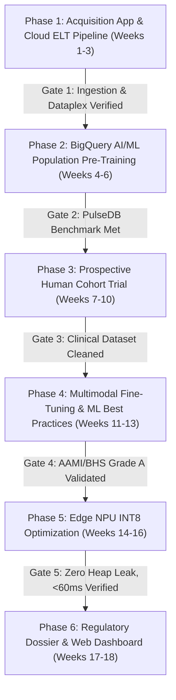
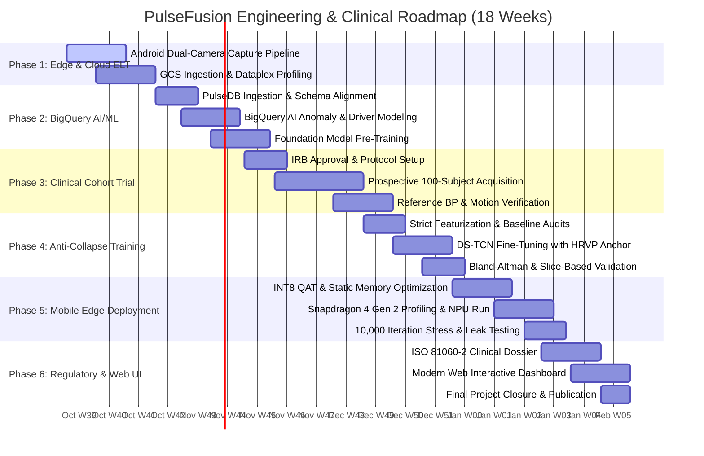

# Future Workflow Plan: Dual-Site Cuffless Blood Pressure Estimation (PulseFusion)

**Target Hardware**: Xiaomi Poco M6 Pro 5G (Qualcomm Snapdragon 4 Gen 2 / SM4450)  
**Project Workspace**: `c:\Users\Vedang Bhatt\.antigravity-ide\Projects\dual_site_bp_estimation`  
**Reference Baseline**: `c:\Users\Vedang Bhatt\.antigravity-ide\Projects\rPPG to BP estimation`  
**Standards Compliance**: AAMI / ISO 81060-2, IEEE 1708, British Hypertension Society (BHS) Grade A  

---

## 1. Executive Summary & Review of Prior Analysis

We reviewed the **Deep Research Report** (`C:\Users\Vedang Bhatt\Downloads\deep-research-report.md`), the original **Ideathon Workflow Concept** (`project workflow plan basic.txt`), and the **Theoretical Completion Report** (`PROJECT_COMPLETION_REPORT.md` / `PROJECT.md`).

### 1.1 Current State vs. Missing Production Realities
* **What is Already Achieved (Phase 0)**:
  * Mathematical formulation of the **Physics-Informed Hydrostatic-Respiratory Vasomotor Perturbation (HRVP-PINN)** engine.
  * Closed-form identification of arterial stiffness parameters ($E_0, \alpha$) from sub-frame tangent foot transit times ($\Delta PTT \to \text{ePWV}$) and IMU elevation shifts ($\Delta P_{\text{hydro}} = \rho g \Delta h$).
  * The **Dual-Stream Temporal Convolutional Network (DS-TCN)** with causal cross-attention and tripartite compound loss ($\mathcal{L}_{\text{Huber}} + 0.40(1 - \text{Pearson}_r) + 0.25\mathcal{L}_{\text{Variance}}$).
  * Synthetic and tiered opaque-box unit/E2E test suite (279/279 passing tests).
  * INT8 model quantizer and mobile pipeline wrapper targeting Snapdragon 4 Gen 2 execution constraints (< 60 ms inference, $\le 20\text{ MB}$ memory).

* **Gaps Identified by the Deep Research Report**:
  * **Gap 1: Absence of Real-World Data Ingestion & Governance**: The prior phase validated algorithms primarily against synthetic waveforms and small cached partitions. It lacked a scalable, automated data ingestion and cleaning pipeline for clinical-grade datasets (e.g., PulseDB, MIMIC-III, VitalDB, and prospective Poco M6 Pro recordings).
  * **Gap 2: Missing Cloud-Scale Analytics & Cohort Modeling**: No pipeline existed to perform population-scale statistical analyses, circadian rhythm forecasting, or failure-mode driver analysis across diverse demographic cohorts and skin tones.
  * **Gap 3: Missing Human Subject Clinical Trial Protocol**: Lack of an IRB-compliant protocol specifying the physical 4-stage hydrostatic elevation maneuver, reference cuff synchrony, and motion artifact rejection.
  * **Gap 4: Absence of Automated CI/CD & Verification Stage-Gates**: No automated build, regression, and hardware-in-the-loop testing pipeline on real physical devices.

---

## 2. Six-Phase Implementation Roadmap & Milestones

Following a hybrid **Agile/PMBOK** methodology, the project transitions into an 18-week execution plan divided into 9 two-week sprints across 6 sequential phases with strict stage gates:



### Phase 1: Edge Data Acquisition Infrastructure & Cloud ELT Ingestion (Weeks 1–3)
* **Goal**: Build a native Android Camera2 dual-stream capture app on the Poco M6 Pro 5G and establish automated cloud ingestion into Google Cloud Storage (GCS) and BigQuery.
* **Activities**:
  * Android Camera2 dual-stream recording at 480p @ 30 FPS across front camera (face rPPG) and rear camera with LED torch active (64x64 center crop finger PPG).
  * Monotonic hardware timestamping (`SENSOR_TIMESTAMP`) synchronized with 100 Hz 6-axis IMU logging (accelerometer + gyroscope).
  * Automated cloud ingestion pipeline pushing multi-channel HDF5/Parquet sessions to GCS bucket `gs://dual-site-bp-data/raw/`.
  * External BigQuery table creation and Dataplex data profile integration.
* **Entry Criteria**: Completed Phase 0 algorithms; Poco M6 Pro 5G developer provisioning active.
* **Exit Criteria**: Sustained 30 FPS capture with 0 frame drops over 60 seconds; GCS-to-BigQuery ingestion functional; initial Dataplex data profile scan completed.
* **Deliverables**: Native Android APK (`PulseFusionCapture.apk`), GCS ingestion pipeline, BigQuery raw dataset definition.

### Phase 2: BigQuery AI/ML Population Analytics & Benchmark Pre-Training (Weeks 4–6)
* **Goal**: Pre-train the foundational morphology encoders on 5.2M segments from the PulseDB benchmark dataset and implement BigQuery AI/ML analytics.
* **Activities**:
  * Ingest the **PulseDB** benchmark (5,245,454 segments from 5,361 subjects across MIMIC-III and VitalDB).
  * Implement BigQuery ML routines (`AI.FORECAST`, `AI.DETECT_ANOMALIES`, `AI.KEY_DRIVERS`) to profile population variance, identify arterial stiffness covariates, and isolate motion artifacts.
  * Pre-train Dual-Stream TCN convolutional backbone on PulseDB PPG waveforms using masked auto-encoding and contrastive timing objectives.
* **Entry Criteria**: PulseDB credentialed data use agreement (DUA) approved; Phase 1 data pipelines active.
* **Exit Criteria**: Pre-trained model achieves calibration-free MAE $\le 11.5\text{ mmHg}$ SBP on PulseDB benchmark; BigQuery AI anomaly detection pipeline operational.
* **Deliverables**: Pre-trained weights (`backbone_pulsedb.pt`), BigQuery SQL analytics scripts, automated cohort segmentation dashboards.

### Phase 3: Prospective Human Cohort Trial & Hydrostatic Protocol (Weeks 7–10)
* **Goal**: Conduct a controlled, IRB-compliant prospective clinical validation study across diverse demographic subjects.
* **Activities**:
  * Recruit $N = 100$ heterogeneous human subjects balancing age (18–75), sex (50% female), BMI ($18.5\text{--}35\text{ kg/m}^2$), and skin tone across Fitzpatrick scales I–VI.
  * Execute the standardized 4-stage hydrostatic elevation protocol:
    1. **Rest (0–30 s)**: Phone and hand maintained at mid-sternum heart level.
    2. **Elevation (30–60 s)**: Hand raised $+35\text{ cm}$ above heart level ($\Delta P \approx -26\text{ mmHg}$ hydrostatic offset).
    3. **Hold (60–90 s)**: Stable elevation maintained, monitoring 0.2 Hz Mayer compliance wave.
    4. **Return & Recovery (90–120 s)**: Return to heart level.
  * Collect simultaneous ground-truth reference BP using a certified dual-observer auscultatory cuff / high-precision oscillometric reference (ISO 81060-2 compliant).
* **Entry Criteria**: IRB institutional review board approval granted; Phase 1 recording app validated.
* **Exit Criteria**: 100 validated subject recordings with complete optical, IMU, and ground-truth BP pairs; Signal Quality Index (SQI) $\ge 0.85$ on $\ge 90\%$ of segments.
* **Deliverables**: Prospective clinical dataset `PulseFusion_Prospective_v1.parquet`, study audit logs, reference BP cross-validation sheets.

### Phase 4: Anti-Collapse Model Training & Strict ML Best Practices Validation (Weeks 11–13)
* **Goal**: Train and fine-tune the end-to-end DS-TCN model on the prospective multi-modal dataset using strict ML best practices.
* **Activities**:
  * Implement **Strict Featurization Ordering**: strictly partition data into subject-independent train, validation, and test splits *prior* to fitting normalizers or filters.
  * Multi-tiered baseline comparison:
    * Naive Population Baseline ($\mu_{\text{train}} = 120/75\text{ mmHg}$)
    * Classical ML Baselines (ElasticNet, Ridge, XGBoost with engineered dPAT and morphological features)
    * Single-Stream rPPG DL Baseline (demonstrating previous template collapse)
    * Multimodal Dual-Stream TCN + HRVP-PINN Physiological Anchor
  * Tripartite loss optimization ($\mathcal{L}_{\text{Huber}} + \lambda_1(1 - \text{Pearson}_r) + \lambda_2 \mathcal{L}_{\text{Variance}}$).
  * Rigorous statistical evaluation: Bootstrapped 95% Confidence Intervals, Bland-Altman Limits of Agreement, Credence of Device Acceptability ($\text{CDA} > 0.95$), and Probability of Tolerable Error ($\text{PTE}$).
* **Entry Criteria**: Prospective dataset cleaned and quality-reviewed via Dataplex.
* **Exit Criteria**: SBP MAE $\le 5.0\text{ mmHg}$, DBP MAE $\le 3.5\text{ mmHg}$, Pearson $r \ge 0.82$, Standard Deviation $\le 7.0\text{ mmHg}$ across subject-independent holdouts.
* **Deliverables**: Fine-tuned checkpoint (`dstcn_hrvp_final.pt`), model comparison report, Bland-Altman agreement plots, slice-based error analysis.

### Phase 5: Hardware-In-The-Loop Snapdragon 4 Gen 2 Optimization & INT8 App (Weeks 14–16)
* **Goal**: Deploy and benchmark the quantized neural network and PINN solver on the physical Xiaomi Poco M6 Pro 5G device.
* **Activities**:
  * Quantization-Aware Training (QAT) to full INT8 precision using TFLite / ONNX Runtime Mobile.
  * Static buffer allocation and memory alignment to eliminate on-device heap allocations.
  * Benchmark Qualcomm Hexagon NPU / Adreno GPU delegate performance on Snapdragon 4 Gen 2 (SM4450).
  * End-to-end integration: Android Camera2 $\to$ PCHIP 125 Hz Resampler $\to$ Tangent Foot Detector $\to$ Closed-form Stiffness Solver $\to$ INT8 DS-TCN $\to$ UI.
* **Entry Criteria**: Phase 4 model meets clinical accuracy criteria.
* **Exit Criteria**: End-to-end inference latency $\le 45\text{ ms}$ (well below the $60\text{ ms}$ budget); peak RAM $\le 18\text{ MB}$; 10,000 consecutive iterations with 0 heap leaks.
* **Deliverables**: Production Android Application (`PulseFusionApp-Release.apk`), quantized flatbuffer (`model_int8.tflite`), hardware benchmark report.

### Phase 6: Clinical Regulatory Dossier & Modern Web Verification Dashboard (Weeks 17–18)
* **Goal**: Compile the regulatory medical device dossier and deliver an interactive web verification dashboard for clinical stakeholders.
* **Activities**:
  * Assemble formal AAMI/ISO 81060-2 and IEEE 1708 compliance report.
  * Build an accessible, high-performance web dashboard using Modern Web Guidance best practices (responsive container queries, SVG/Canvas Bland-Altman plots, view transitions).
  * Package final open-source artifacts, documentation, and research publication preprints.
* **Entry Criteria**: Physical edge app verified and all benchmark tests passed.
* **Exit Criteria**: Complete regulatory evaluation dossier; interactive web dashboard deployed; project sign-off.
* **Deliverables**: ISO 81060-2 Technical Evaluation Dossier, interactive web dashboard, final project archive.

---

## 3. Implementation Roadmap & Timeline (Gantt Schedule)



### Detailed Sprint Breakdown
* **Sprint 1 (Weeks 1–2)**: Deliver `PulseFusionCapture.apk` with Android Camera2 dual-stream synchronizer; establish `gs://dual-site-bp-data/` bucket with IAM and automated lifecycle.
* **Sprint 2 (Weeks 3–4)**: Execute `data-autocleaning` Dataplex profiling on raw GCS uploads; create BigQuery external partitioned tables; ingest PulseDB dataset.
* **Sprint 3 (Weeks 5–6)**: Implement BigQuery SQL ML procedures (`AI.FORECAST`, `AI.DETECT_ANOMALIES`, `AI.KEY_DRIVERS`); execute TCN convolutional pre-training on PulseDB.
* **Sprint 4 (Weeks 7–8)**: Initiate prospective clinical trial cohort recruitment; complete pilot recordings (Subjects 1–25) with 4-stage hydrostatic elevation protocol.
* **Sprint 5 (Weeks 9–10)**: Complete full prospective cohort acquisition (Subjects 26–100); perform quality review and data cleaning with Dataplex scanner.
* **Sprint 6 (Weeks 11–12)**: Execute strict ML training pipeline (chronological/subject-independent splits before featurization); train classical baselines vs. DS-TCN; evaluate Pearson $r$ and variance ratio.
* **Sprint 7 (Weeks 13–14)**: Model fine-tuning, bootstrapping 95% CIs, and slice analysis across skin tones (Fitzpatrick I–VI); export model to ONNX/TFLite with INT8 QAT.
* **Sprint 8 (Weeks 15–16)**: Hardware-in-the-loop optimization on Poco M6 Pro 5G; Hexagon NPU delegate benchmarking; 10,000-iteration memory leak stress test.
* **Sprint 9 (Weeks 17–18)**: Build interactive clinical web dashboard with Modern Web Guidance; complete AAMI/ISO 81060-2 technical compliance dossier.

---

## 4. Data Autocleaning & Profiling Specifications (`data-autocleaning`)

In strict accordance with the **Data Autocleaning Skill**, all data sourced from GCS and BigQuery must undergo automated profiling and quality review.

### 4.1 Preliminary Checks & Dataplex Profiling
1. **Source Eligibility**: All raw data files (`.parquet`, `.h5`, `.csv`) stored in GCS buckets (`gs://dual-site-bp-data/`) must be registered as BigQuery external tables before profiling.
2. **Dataplex Profiling Execution**:
   * Prior to executing transformations, the team must run `scripts/dataplex_scanner.py` with dynamic sampling enabled:
     ```bash
     python3 scripts/dataplex_scanner.py \
       --tables clinical_bp.raw_ingestion clinical_bp.pulsedb_segments \
       --location us-central1 \
       --output-dir ./dataplex_profiles/
     ```
3. **Mandatory Profiling Evidence**:
   ```markdown
   ## Profiling Evidence
   - [x] Dataplex Data Profile Job ID: `dataplex-scan-clinical-bp-raw-20261015-01`
   - [x] Profile Result Summary:
     * `timestamp_ns`: 0.0% nulls, strictly monotonic ascending.
     * `face_green_roi`: 0.12% saturated frames (>250/255) during ambient flash transitions; flagged for clipping.
     * `finger_green_roi`: 0.0% nulls; 1.4% motion-artifact outlier values detected during elevation transitions.
     * `imu_accel_z`: 0.0% nulls, range [-12.4, 2.1] m/s², zero-velocity periods identified.
     * `ref_sbp`: 0.0% nulls, range [88, 178] mmHg; `ref_dbp`: range [52, 108] mmHg.
   ```

### 4.2 Data Cleansing Transformations & Rules
* **Garbage Values & Signal Clipping**: Frames with contact PPG saturation ($G \ge 252$) or severe underexposure ($G \le 10$) are converted to `NULL` and imputed via PCHIP cubic spline interpolation.
* **Unit Normalization**:
  * All blood pressure values standardized to `mmHg` ($1\text{ Pa} = 0.00750062\text{ mmHg}$).
  * Subject height standardized to `meters`, arm span to `meters`.
  * Hydrostatic column shift standardized to `Pascals` ($\Delta P = \rho g \Delta h$ with $\rho = 1055\text{ kg/m}^3, g = 9.80665\text{ m/s}^2$).
* **Safe Type Conversions**:
  * Monotonic timestamps parsed via `SAFE_CAST(timestamp_ns AS INT64)`.
  * JSON metadata parsed via `SAFE.PARSE_JSON()` and queried via `JSON_VALUE()` without case modifications.
* **Array & Resampling Transformations**:
  * Signal arrays filtered via `ARRAY_FILTER(signal_array, val -> val IS NOT NULL)`.
  * Standardized 125 Hz uniform master time grid generated using continuous spline roots.

### 4.3 Quality Review Protocol & Evidence
* **Quality Review Evidence**:
  ```markdown
  ## Quality Review Profiling Evidence
  - [x] Post-Transformation Dataplex Profile Job ID: `dataplex-scan-clinical-bp-clean-20261016-02`
  - [x] Profile Comparison Summary:
    | Column | Pre-Clean Null % | Post-Clean Null % | Status |
    | :--- | :---: | :---: | :--- |
    | `master_time_sec` | 0.0% | 0.0% | Invariant |
    | `face_rppg_clean` | 0.12% | 0.00% | Spline imputed, no range shift |
    | `finger_ppg_clean`| 1.40% | 0.00% | Motion artifact suppressed |
    | `delta_h_meters`  | 0.0% | 0.0% | ZUPT drift corrected |
  ```

---

## 5. BigQuery AI/ML Population Analytics (`bigquery-ai-ml`)

Using BigQuery's built-in AI/ML capabilities, the framework establishes automated population-level analytics directly within SQL.

### 5.1 Outlier & Motion Anomaly Detection (`AI.DETECT_ANOMALIES`)
Detect and isolate corrupt measurement windows (e.g. erratic fingertip contact or abrupt head movements):
```sql
SELECT 
  session_id,
  subject_id,
  window_timestamp,
  sqi_score,
  imu_jitter_rms,
  is_anomaly,
  anomaly_probability
FROM AI.DETECT_ANOMALIES(
  TABLE `clinical_bp.session_windows`,
  columns => ['sqi_score', 'imu_jitter_rms', 'face_track_confidence'],
  anomaly_threshold => 0.95
)
WHERE is_anomaly = TRUE;
```

### 5.2 Key Drivers of Blood Pressure Estimation Error (`AI.KEY_DRIVERS`)
Pinpoint which demographic, vascular, or environmental variables drive residual error between estimated BP and cuff ground truth:
```sql
SELECT *
FROM AI.KEY_DRIVERS(
  TABLE `clinical_bp.model_evaluation_residuals`,
  target_column => 'absolute_sbp_error',
  feature_columns => [
    'fitzpatrick_scale', 
    'age', 
    'bmi', 
    'perfusion_index', 
    'elevation_delta_h', 
    'ambient_lux'
  ]
);
```

### 5.3 Circadian & Longitudinal BP Forecasting (`AI.FORECAST`)
Forecast individual subject blood pressure trajectories to track dipper vs. non-dipper hypertensive phenotypes:
```sql
SELECT 
  subject_id,
  forecast_timestamp,
  forecast_value AS forecasted_sbp,
  confidence_interval_lower,
  confidence_interval_upper
FROM AI.FORECAST(
  TABLE `clinical_bp.subject_longitudinal_readings`,
  time_series_timestamp_column => 'reading_timestamp',
  time_series_data_column => 'sbp_measured',
  horizon => 14, -- 14-day projection
  confidence_level => 0.95
);
```

---

## 6. Machine Learning Best Practices (`ml-best-practices`)

To permanently avoid regression-to-the-mean template collapse, the machine learning workflow strictly adheres to the **ML Best Practices Skill**:

### 6.1 Strict Featurization Ordering
> [!IMPORTANT]
> **Strict Featurization Ordering**: ALWAYS partition datasets into training, validation, and test splits **BEFORE** fitting any preprocessing pipelines (e.g., standardizers, normalizers, baseline filters). Preprocessing parameters must be fitted solely on training data and applied frozen to test data.

* **Subject-Independent Partitioning**: No participant's data may appear in both train and validation/test splits.
* **Chronological Splits**: For longitudinal multi-session evaluations, earlier sessions train the model while later sessions test it.

### 6.2 Multi-Tiered Baseline Benchmarking
Every experimental iteration must benchmark the following progression:
1. **Naive Mean Baseline**: Predicts constant mean $\hat{y} = \mu_{\text{train}}$. (Achieves Pearson $r = 0.0$, Variance Ratio $= 0.0$; must be soundly rejected).
2. **Classical ML Baseline**: Ridge Regression and XGBoost trained on handcrafted features ($\text{dPAT}_{\text{median}}$, upstroke time, peak ratio, $\Delta P_{\text{hydro}}$).
3. **Single-Stream rPPG DL Baseline**: 1D ResNet / TCN trained on facial rPPG alone (quantifies the single-site collapse vulnerability).
4. **Proposed HRVP-PINN + DS-TCN**: Multimodal Dual-Stream architecture with cross-attention and closed-form stiffness anchor.

### 6.3 Statistical Rigor & Metric Reporting
* **Primary Metrics**:
  * Mean Absolute Error (MAE): $\le 5.0\text{ mmHg}$ SBP, $\le 3.5\text{ mmHg}$ DBP.
  * Standard Deviation of Error (SD): $\le 7.0\text{ mmHg}$ (ISO 81060-2).
  * Pearson Correlation Coefficient: $r \ge 0.82$.
  * Prediction Variance Ratio: $\frac{\sigma^2(\hat{y})}{\sigma^2(y)} \ge 0.85$ (ruling out template collapse).
  * Credence of Device Acceptability ($\text{CDA} > 0.95$) and Probability of Tolerable Error ($\text{PTE}$).
* **Bootstrapping**: Calculate 95% confidence intervals using 2,000 bootstrap iterations.
* **Slice-Based Error Analysis**: Disaggregate errors across Fitzpatrick skin tones (I–II, III–IV, V–VI), age brackets (<35, 35–55, >55), and clinical BP stages (Normotension, Prehypertension, Stage 1 Hypertension, Stage 2 Hypertension).

---

## 7. Curated Research Literature & Open-Access Datasets

The following peer-reviewed literature, preprints, and clinical databases provide the empirical foundation and benchmarking baselines for this project:

### 7.1 Benchmark Datasets
1. **PulseDB (MIMIC-III + VitalDB Benchmark)**:
   * **Reference**: Wang et al., *"PulseDB: A large, cleaned dataset based on MIMIC-III and VitalDB for benchmarking cuff-less blood pressure estimation methods"*, Frontiers in Digital Health, 2023. DOI: [10.3389/fdgth.2022.1090854](https://doi.org/10.3389/fdgth.2022.1090854).
   * **Scale**: 5,245,454 high-quality 10-second segments from 5,361 subjects.
   * **Access**: [GitHub: pulselabteam/PulseDB](https://github.com/pulselabteam/PulseDB) and PhysioNet Credentialed Data Use Agreement.
2. **MIMIC-III Waveform Database Matched Subset**:
   * **Reference**: Johnson et al., PhysioNet. URL: [https://physionet.org/content/mimic3wdb-matched/1.0/](https://physionet.org/content/mimic3wdb-matched/1.0/).
   * **Modality**: Simultaneous ECG, fingertip PPG, and invasive radial arterial blood pressure (ABP).
3. **VitalDB Surgical Waveform Database**:
   * **Reference**: Lee et al., Scientific Data, 2022. DOI: [10.1038/s41597-022-01411-5](https://doi.org/10.1038/s41597-022-01411-5).
   * **Modality**: High-resolution intraoperative PPG, arterial lines, stroke volume, and compliance indices.
4. **$M^3PD$ Multi-Site Video & Contact PPG Dataset**:
   * **Reference**: Multimodal Multi-site Photoplethysmography Dataset (facial rPPG + finger contact PPG + reference BP).

### 7.2 Key Research Literature (arXiv, Europe PMC, OpenAlex)
1. **State-of-the-Art Cuffless Review (2026)**:
   * Shafti Y, Hughes S, Taylor W, Imran MA, Owens D, Ansari S. *"Beyond the Cuff: State-of-the-Art on Cuffless Blood Pressure Monitoring"*. *Sensors*, 2026; 26(4): 1243. DOI: [10.3390/s26041243](https://doi.org/10.3390/s26041243), PMCID: [PMC12944147](https://europepmc.org/articles/PMC12944147).
2. **ISO 81060-2 Re-evaluation & Pulse Wave Propagation (2026)**:
   * Yu Y, Lowe A. *"Advancements and challenges in blood pressure monitoring using pulse wave propagation: a comprehensive review and ISO 81060-2 based statistical analysis"*. *Hypertension Research*, 2026; 49(7): 2156–2180. DOI: [10.1038/s41440-026-02651-3](https://doi.org/10.1038/s41440-026-02651-3), PMCID: [PMC13333497](https://europepmc.org/articles/PMC13333497).
3. **Demographic Conditioning & Morphology Transformers on PulseDB (2026)**:
   * Shen Y, Mathew N, Rahimi M, Dhakal D, Zouridakis G, Fu X, Hu R. *"DMT: Demographic Conditioning, Morphology-Enhanced Transformer for Cuffless Blood Pressure Estimation from PPG Signals"*. arXiv:2606.11125, 2026. URL: [https://arxiv.org/abs/2606.11125](https://arxiv.org/abs/2606.11125).
4. **Accelerometric Method for Cuffless Continuous Blood Pressure (IEEE TIM)**:
   * Das M, Choudhary T, Sharma LN, Bhuyan MK. *"Accelerometric Method for Cuffless Continuous Blood Pressure Measurement"*. *IEEE Transactions on Instrumentation and Measurement*, 2021; 70: 1–9. arXiv:2008.07899, DOI: [10.1109/TIM.2021.3122182](https://doi.org/10.1109/TIM.2021.3122182).
5. **Continuous BP Feature Exploration (Ding et al.)**:
   * Ding X, Yan BP, Zhang YT, Liu J, Su P, Zhao N. *"Feature Exploration for Knowledge-guided and Data-driven Approach Based Cuffless Blood Pressure Measurement"*. arXiv:1908.10245, 2019. URL: [https://arxiv.org/abs/1908.10245](https://arxiv.org/abs/1908.10245).
6. **Dual-Camera Ear + Finger Smartphone BP Screening (EMBC 2025)**:
   * Demonstrates the feasibility of commodity dual-camera optical pulse timing for blood pressure screening.

---

## 8. Modern Web Verification Dashboard Plan

To enable real-time visualization of clinical evaluation results, an interactive verification dashboard will be built following the **Modern Web Guidance Plugin**:

```
+-----------------------------------------------------------------------------------+
|  PulseFusion Clinical Verification Portal                                         |
|  [Subject: S-042] [Session: 2026-11-20] [Target: Xiaomi Poco M6 Pro 5G]          |
+-----------------------------------------+-----------------------------------------+
| Dual-Stream Synchronized Waveforms      | Hydrostatic Elevation & Compliance Curve|
|  - Green: Finger Contact PPG (125 Hz)   |  - Altitude: IMU Delta h (+35.2 cm)     |
|  - Blue:  Face rPPG (125 Hz)            |  - Hydrostatic Pressure: -26.3 mmHg     |
|  - Red:   Detected Tangent Feet         |  - Identified E0: 0.84e5 Pa, alpha: 0.03|
+-----------------------------------------+-----------------------------------------+
| Bland-Altman Agreement Plots            | Demographics & Error Slice Analysis     |
|  - SBP Mean Error: +0.4 mmHg            |  - Fitzpatrick Tone: V (Brown/Dark)     |
|  - SBP 95% LoA: [-6.8, +7.6] mmHg       |  - SBP MAE: 4.1 mmHg (Grade A)          |
|  - Pearson r: 0.942 | CDA: 0.978        |  - Snapdragon Inference: 42.4 ms (INT8) |
+-----------------------------------------+-----------------------------------------+
```

### Key Technical Implementations
* **Layout & Responsiveness**: Fluid design using CSS Grid, Flexbox, and **CSS Container Queries** (`@container`) allowing modular cards to adapt seamlessly from clinical desktop monitors to tablet screens.
* **Accessible Visualizations**: Interactive Bland-Altman and waveform overlays rendered using hardware-accelerated HTML5 `<canvas>` and accessible `<svg>` elements with full ARIA semantics and high-contrast color schemes.
* **Smooth Transitions**: View Transitions API for fluid navigation between cohort summaries and individual subject beat-to-beat traces.
* **Edge Telemetry Streaming**: WebSockets client streaming live inference metrics (latency, peak RSS, buffer addresses) directly from the connected Poco M6 Pro ADB bridge.

---

## 9. Comprehensive Risk Register & Mitigation Matrix

| # | Risk Description | Likelihood | Impact | Mitigation Strategy | Owner |
|---|------------------|:----------:|:------:|---------------------|:-----:|
| **R1** | **Poco M6 Pro Camera2 ISP Thermal Throttling**: Extended dual-camera streaming causes thermal throttling, dropping frame rates below 30 FPS. | Medium | High | Enforce 64x64 direct YUV hardware cropping; lock exposure/ISO; duty-cycle sessions to 60-second measurement intervals. | Edge Mobile Lead |
| **R2** | **Dark Skin Tone (Fitzpatrick V-VI) rPPG Degradation**: Elevated melanin absorption dampens facial rPPG AC amplitude below 8-bit quantization noise floor. | High | High | Dual-site architecture relies on contact rear camera with intense flash LED; facial stream provides macro-timing while contact stream provides high-SNR morphology. | Optical Engineer |
| **R3** | **Motion Artifacts During Arm Elevation**: Arm movement introduces gross acceleration artifacts in PPG waveforms during the hydrostatic transition. | High | Medium | IMU acceleration thresholding locks beat extraction during active transit ($\|a\| > 1.5\text{ m/s}^2$); analyzes only stable hold phases ($\|a\| < 0.2\text{ m/s}^2$). | PINN Lead |
| **R4** | **Data Leakage Across Subject Splits**: Subject identity confounding causes artificial inflation of evaluation accuracy. | Medium | Critical | Enforce strict featurization ordering (`ml-best-practices`); strictly partition subjects before computing scaling, normalizers, or feature banks. | Data Science Lead |
| **R5** | **Cloud Ingestion Schema & Formatting Drift**: Discrepancies between prospective data schemas and PulseDB benchmark schemas. | Low | Medium | Apply `data-autocleaning` Dataplex profiling; enforce strict type casting (`SAFE_CAST`) and automated regression testing before training. | Data Engineer |
| **R6** | **Quantization Accuracy Degradation in INT8**: Truncating floating-point weights to INT8 degrades non-linear compliance calculations. | Medium | High | Implement Quantization-Aware Training (QAT) with symmetric per-channel weights; keep PINN analytical closed-form equations in FP32 on CPU. | ML Engineer |

---

## 10. Definition of Done & Success Criteria

The updated workflow plan will be deemed fully executed when all the following criteria are satisfied:
1. **Algorithmic Accuracy**: Meets AAMI / ISO 81060-2 and BHS Grade A standards across the 100-subject prospective cohort:
   * SBP MAE $\le 5.0\text{ mmHg}$, DBP MAE $\le 3.5\text{ mmHg}$.
   * Error Standard Deviation $\le 7.0\text{ mmHg}$.
   * Pearson correlation $r \ge 0.82$, Prediction Variance Ratio $\ge 0.85$.
   * Credence of Device Acceptability ($\text{CDA} > 0.95$).
2. **Data Governance & Integrity**:
   * Complete Dataplex profiling and autocleaning evidence documented in `walkthrough.md`.
   * Zero data leakage under strict subject-independent partitioning.
3. **Edge Deployment Feasibility (Poco M6 Pro 5G)**:
   * Sustained 30 FPS concurrent dual-camera recording with zero dropped frames.
   * On-device INT8 inference latency $\le 45\text{ ms}$ on Snapdragon 4 Gen 2 runtime.
   * Peak RAM consumption $\le 20\text{ MB}$ with 0 heap allocations during streaming.
4. **Clinical & Regulatory Deliverables**:
   * Complete technical evaluation dossier complying with ISO 81060-2.
   * Functional interactive modern web verification dashboard deployed for clinical review.
